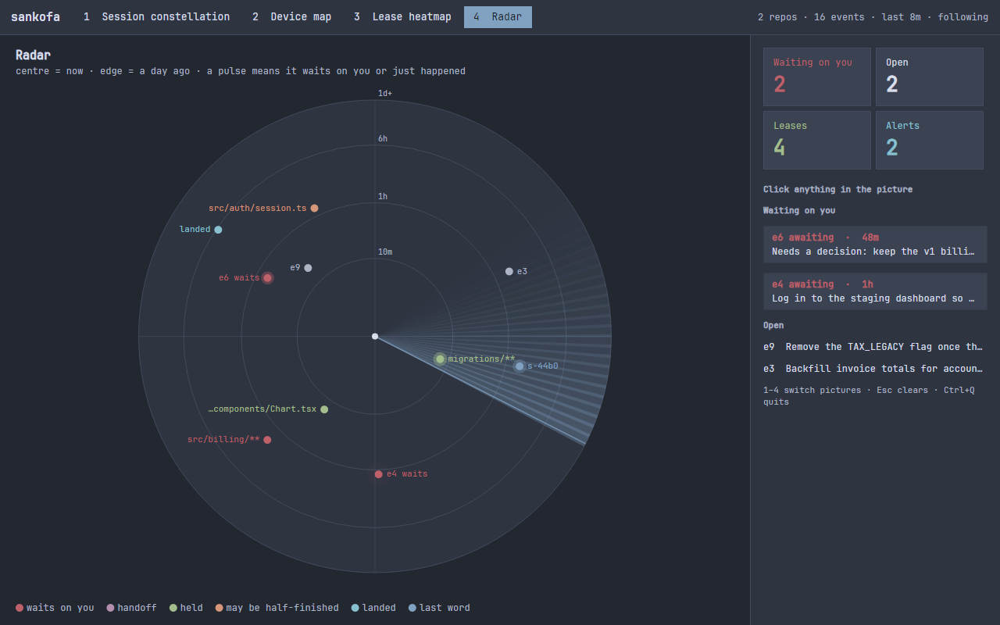

# sankofa

*Sankofa* (Akan): "go back and fetch it." The bird that looks back to pick up
what was left behind.

**Shared memory and file locks for all your AI coding sessions.** One small
ledger that every session, subagent, client and machine goes back to: what was
done, what is open, who is working on which files, what to do next. When you
run out of credits at midnight, the branch and its context go to a teammate
with one command.

<a href="docs/images/radar.png"></a>

## Get it

Linux and macOS, one line:

```sh
curl -fsSL https://raw.githubusercontent.com/nerdcules/sankofa/main/get.sh | sh
```

Windows: unzip the package, add it to PATH, run `sankofa setup`. Also as a
`.deb`, a tarball, an Arch package, or from source: [docs/INSTALL.md](docs/INSTALL.md).
Every package holds the same programs, so a Linux desktop, a Mac and a Windows
machine share one ledger and hand branches to each other.

## Sixty seconds

```sh
cd ~/Work/some-repo
sankofa init                                     # a .sankofa/ folder; commit it or ignore it
sankofa todo "write the PKGBUILD"                # e3
sankofa awaiting "sudo pacman -U the built package"   # e4: needs you; a toast on the desktop
sankofa note "built and tested; package not yet installed"
# ... /clear, a crash, a second client, another machine ...
sankofa open                                     # e3 and e4 are still there
```

Now two sessions on one repo. With Claude Code every edit is leased before
it happens, so the second one is refused by name:

```sh
sankofa claim 'src/net/**'          # session A: mine for 30 minutes (e5)
sankofa ask src/net/socket.c        # session B: held by A, since 2 min
sankofa done e5                     # A is done; B's next edit goes through
```

Out of credits? `sankofa handoff "parser done; next: error messages"` pushes
the branch and a letter; your teammate runs `sankofa pickup` and continues.

## What it does

- **Remembers across sessions.** Notes, todos and "needs you" items in a
  ledger file in the repo, read by the next session without any transcript.
- **Refuses the second edit.** A hook on every edit leases the file to the
  session or subagent; another holder is told who has it. Four milliseconds.
- **Refuses the commit** that touches a file someone else holds, in any client.
- **Notices what it cannot prevent.** Two worktrees changing one file, a
  branch that landed from a cloud run overnight.
- **Shares one ledger between your machines** through a hub, with offline
  writes queued and replayed.
- **Hands a branch to a teammate** over nothing but the git remote, taken
  once and never twice.
- **Shows all of it in one screen**, in the terminal or a window.

Every client that speaks MCP or runs a shell command can use it. Adapters
exist for Claude Code (hooks and MCP) and Codex (hook and MCP); the git gate
covers the rest. It is a substrate, not an agent: it records and answers, it
never decides.

## Numbers

Each part shipped with a simulation that drives the real code through a week
of use in minutes ([docs/ROADMAP.md](docs/ROADMAP.md)):

| | |
|---|---|
| Five agents on one repo, with the edit gate off | about 17 clobbered files a run |
| the same, with it on | none |
| Desk, laptop and a cloud session on one hub, network cut and restored, 5 weeks | 1,749 writes, none lost or doubled |
| Four people handing branches around one remote, 35 races for one handoff | none taken twice |
| The edit gate, as a process, per edit | 4 ms |

## Read next

| You are | Read |
|---|---|
| trying it | [docs/INSTALL.md](docs/INSTALL.md), then [docs/GUIDE.md](docs/GUIDE.md) |
| an AI agent working in a repo with a ledger | [AGENTS.md](AGENTS.md) |
| building or changing it | [docs/DEVELOPING.md](docs/DEVELOPING.md), [docs/OBJECTIVE.md](docs/OBJECTIVE.md), [docs/ROADMAP.md](docs/ROADMAP.md) |
| wondering how this came about | [docs/STORY.md](docs/STORY.md) |
| comparing it with other tools | [docs/PRIOR-ART.md](docs/PRIOR-ART.md) |

## Status

Iteration 0.14. Everything runs on Linux, macOS and Windows: the command, the
daemon and its gates, the MCP server, the hub, the notifier, and the dashboards
in the terminal and in a window. The same code on every system, so any of them
shares a ledger, a hub and a git remote with any other. MIT licence.
