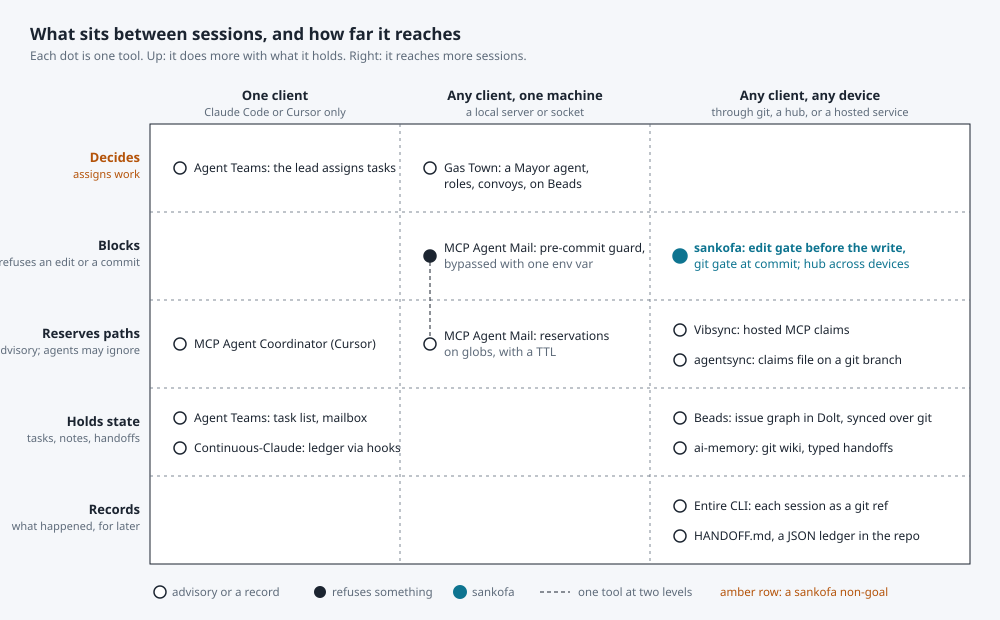
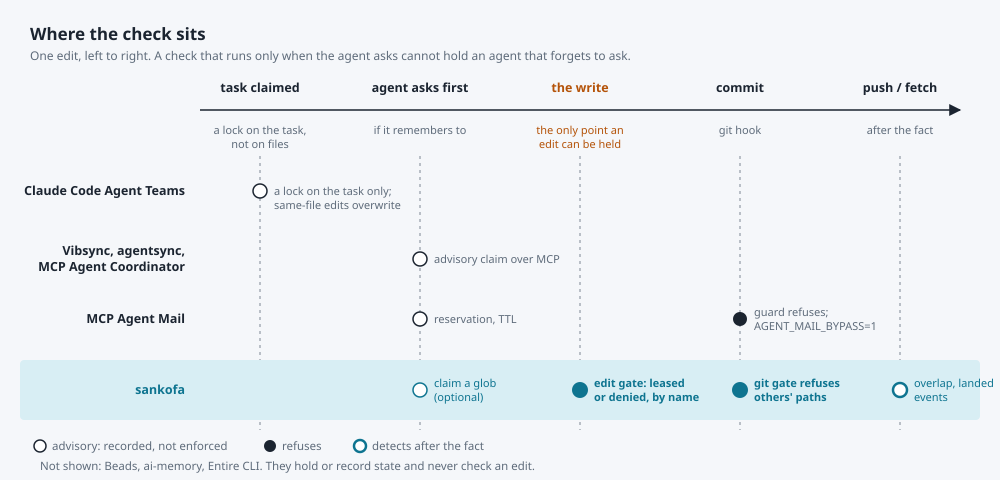

# Prior art

What else sits between AI coding sessions, and where sankofa differs. Checked
against each project's own README or docs on 2026-11-13; the three claim
servers at the end are described from their own pages only. Versions move
fast, so treat every row as "as of that date".

## The short answer

Nothing has the same shape end to end. One project, MCP Agent Mail, overlaps
heavily: path reservations with a TTL, SQLite plus a git archive, a pre-commit
guard, a TUI. The rest cover one half each: memory and handoff on one side,
orchestration on the other. None checks an edit at the moment it happens, and
none shares one lease table across devices.

*Hollow: advisory or a record. Filled: refuses something. Teal: sankofa.
Amber row: a sankofa non-goal.*

Figure 1. What each tool does with what it holds (up) and how far it reaches
(right). Most of the field is in the lower right: state and records that
travel through git. The upper row is orchestration, which sankofa's objective
rules out. The gap sankofa fills is the cell between them: refusing an edit or
a commit, from any client, on any device.

## Tool by tool

| Tool | Holds | Enforcement | Clients | Reach | Notes |
|---|---|---|---|---|---|
| **MCP Agent Mail** (Jeffrey Emanuel; Python, Rust port) | identities, inboxes, threads, file reservations on globs with a TTL | advisory; optional pre-commit and pre-push guard, bypassed with `AGENT_MAIL_BYPASS=1` | Claude Code, Codex CLI, Gemini CLI, Copilot CLI, any MCP client; `am` CLI for shells | one server process per mailbox; HTTP if exposed | SQLite live state, git archive. Says no to worktrees by design. TUI, web UI. MIT with a rider that grants no rights to OpenAI or Anthropic. |
| **Beads** (Steve Yegge) | an issue graph with dependencies, agent memories | none on paths; a task can be claimed atomically | any agent that runs `bd` | synced over the git remote (`refs/dolt/data`) | Dolt is the store; the JSONL file is an export. `bd prime` prints context for a new session. MIT. |
| **Gas Town** (same author) | work on "hooks" that survive restarts, convoys, mailboxes | n/a: it decides | Claude Code first | one machine | An orchestrator on Beads: a Mayor, roles, `gt handoff`. Everything sankofa's non-goals list. MIT. |
| **Claude Code Agent Teams** | shared task list, per-teammate inbox | a lock on task claiming only; "two teammates editing the same file leads to overwrites" | Claude Code | one session; task list stays on disk, teammates do not survive `/resume` | Experimental, off by default. Covered in `agent-channels.md`. |
| **ai-memory** (akitaonrails) | a git-backed markdown wiki of sessions; typed handoffs with one owner | none on paths; a per-workstream lease that `--force-unlock` clears | more than twenty harnesses | wherever the git repo goes | The closest thing to a cross-client handoff. No notion of who holds what. MIT. |
| **Continuous-Claude-v3**, **Handoff** (HANDOFF.md), the **pull-based JSON ledger** | a continuity ledger or a short handoff file in the repo | none | Claude Code only (Continuous-Claude); any (the others) | the repo | Cover G2, cold-start handoff, by convention: the next session reads a file. |
| **Entire CLI** | every agent session, as a checkpoint under `refs/entire/checkpoints/…` next to the commit it produced | none; a record | Claude Code, Codex, Cursor, Copilot CLI, OpenCode and more | pushed with the code | How the code was written, searchable. Tracks worktrees separately. Pushes transcripts to the remote; redaction is best effort. MIT. |
| **Vibsync**, **agentsync** MCP, **MCP Agent Coordinator** | claims on paths | advisory; "not a distributed mutex" | MCP clients; Coordinator is for Cursor | Vibsync is hosted; agentsync keeps a claims file on a git branch | No expiry or stale-claim story found on their pages. |

## Where the check sits

*Hollow: advisory. Filled: refuses. Ringed: detects after the fact.*

Figure 2. One edit, left to right. Every other tool's check runs before the
write, and only when the agent calls it. An agent that forgets, or a client
whose prompt never mentioned the tool, is not held. The write itself is the
one point where a hook can refuse, and only sankofa's edit gate sits there.
MCP Agent Mail's guard is the nearest neighbour, one station later, at commit.

## What is not elsewhere

- **A gate at the write.** `sankofad gate claude-code` runs as a PreToolUse
  hook: the edit is leased or denied before the file changes. Everything else
  is advisory or at commit.
- **Leases that know about half-finished work.** A lease carries a dirty mark;
  release and expiry keep it, and the daemon clears it only when git shows the
  paths committed. The next holder is told the edit may be half done. The
  TTL-only reservations elsewhere forget this.
- **Detection where prevention is impossible.** `overlap` when two worktrees
  change one path, `landed` when a remote moved while you were away. MCP Agent
  Mail avoids the problem by forbidding worktrees.
- **One ledger across devices and clients.** The hub shares events and the
  lease table between machines and with cloud sessions over MCP, and the same
  verbs work from a shell, a hook, or an MCP tool. Beads and Entire travel
  through git; Agent Mail is one process; Agent Teams is one session.
- **A substrate that never decides.** No roles, no assignment, no messages.
  That is a choice, not a gap, and it is the whole upper row of Figure 1.

## What they have that sankofa does not

- **Messaging.** Agent Mail's inboxes and threads; Agent Teams' mailbox. sankofa
  leaves that to the client's own channel on purpose.
- **A dependency graph.** Beads blocks a task on others. sankofa's todos are
  flat.
- **Session capture.** Entire keeps the whole transcript next to the commit.
  sankofa keeps what the agent chose to note.
- **A hosted service.** Vibsync needs no daemon. sankofa needs `sankofad`, or a
  hub you run.
- **Scale claims.** Agent Mail's site says 40 to 50 concurrent agents on one
  project. sankofa's simulations (`sim/`) run a week of a few sessions, not a
  swarm.

## Sources

- MCP Agent Mail: <https://github.com/Dicklesworthstone/mcp_agent_mail>,
  <https://github.com/Dicklesworthstone/mcp_agent_mail_rust>,
  <https://www.mcpagentmail.com/>
- Beads: <https://github.com/steveyegge/beads>
- Gas Town: <https://github.com/gastownhall/gastown>, <https://gastown.dev/docs/intro>
- Claude Code Agent Teams: <https://code.claude.com/docs/en/agent-teams>
- ai-memory: <https://github.com/akitaonrails/ai-memory>
- Continuous-Claude-v3: <https://github.com/parcadei/Continuous-Claude-v3>
- Handoff: <https://hol.org/blog/introducing-handoff>
- Pull-based JSON handoff ledger:
  <https://dev.to/morinaga/how-i-coordinate-claude-and-codex-sessions-with-a-pull-based-json-handoff-ledger-5h93>
- Entire CLI: <https://github.com/entireio/cli>
- Vibsync: <https://dev.to/_3ffb5be7950c3a975b5d/how-to-prevent-multiple-ai-coding-agents-from-editing-the-same-files-4aib>
- agentsync MCP: <https://glama.ai/mcp/servers/pjjw8swlvp>
- File-level locking for shared codebases (MCP Agent Coordinator):
  <https://dev.to/authora/stop-your-ai-coding-agents-from-fighting-file-level-locking-for-shared-codebases-3pej>
