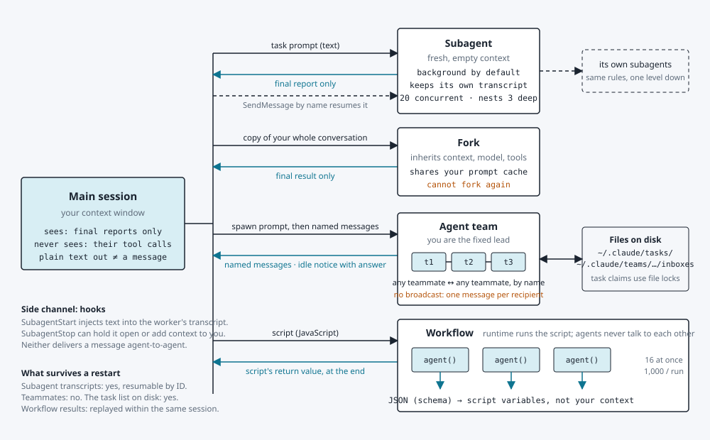
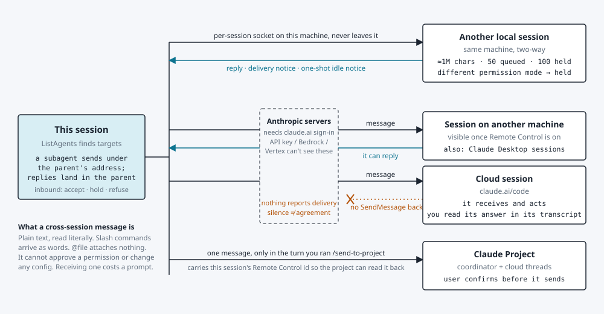
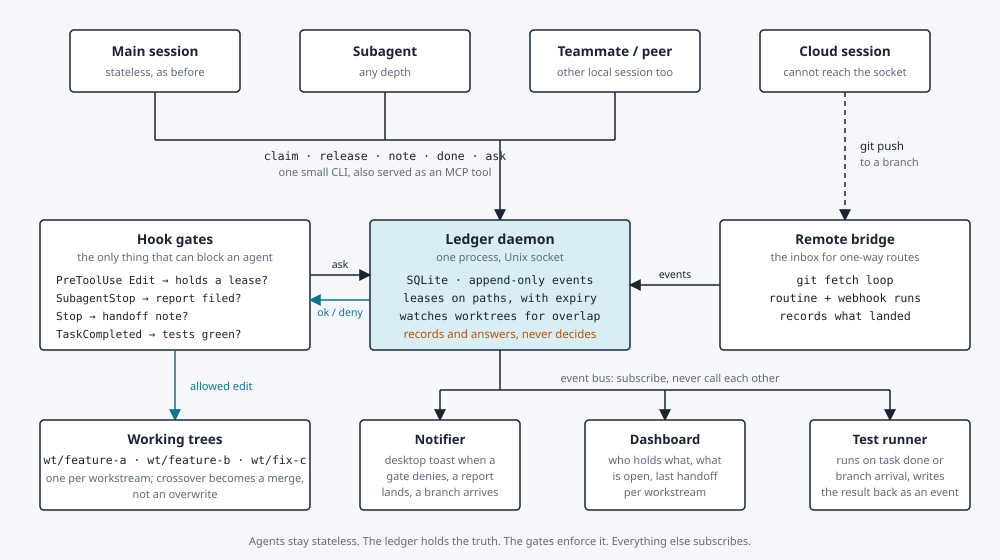

# How sessions and agents talk to each other

*Claude Code: sessions, subagents, teams, workflows. Checked against the docs on 2026-11-10.*

Every agent runs in its own context window. The only thing that ever crosses
the wall between two of them is plain text: a prompt going in, a report or
message coming out. The figures below show each channel, what it carries, and
where it stops.

## Inside one session

Your main conversation can spawn four kinds of workers. In every case the
worker's tool calls and intermediate results stay inside the worker. Only the
arrow drawn in teal returns to you.

*Solid arrows: plain text going in. Teal arrows: what comes back to you.
Dashed: optional, by name.*

Figure 1. Four ways one session delegates work. The worker's context window is
a wall. A subagent starts empty, a fork starts as a copy of you, a team is many
named peers, a workflow is a script that collects structured answers. In every
case you receive text at the end, not the work in progress.

## Between sessions

Separate Claude Code sessions can message each other too. The route depends on
where the other session runs, and the route decides whether an answer can come
back.

*Solid: message out. Teal: can come back. Amber stop: cannot come back.*

Figure 2. Three routes between sessions and one into a Project. The local
socket is the only route with delivery feedback. Through Anthropic servers a
session on another machine can answer, a cloud session cannot. Every message is
plain text and never carries permissions.

## Every channel at a glance

| Channel | Direction | What crosses | Shared context? | Lives on after | Hard limits |
|---|---|---|---|---|---|
| Subagent | parent → child, child → parent once | prompt in; final report out; later messages by name | No. Starts empty (gets CLAUDE.md, git status, skills) | Transcript kept, resumable by ID | 20 concurrent by default; 3 levels of nesting; no AskUserQuestion or Workflow inside |
| Fork | parent → copy, copy → parent once | whole conversation in; final result out | Yes, a snapshot at spawn time; diverges after | Same as a subagent | A fork cannot fork; always your model and effort |
| Agent team | lead ↔ teammate, teammate ↔ teammate | named text messages; shared task list; idle notices | No. Each teammate has its own window | Task list on disk; teammates do not survive /resume | Interactive sessions only; one team per session; no nested teams; no broadcast; about 7x tokens in plan mode |
| Workflow | script → agents, agents → script | prompt in; JSON matching a schema out, into script variables | No. Agents do not see each other | Results replay on resume in the same session | 16 concurrent by default; 1,000 agents per run; 4,096 items per parallel call; no user input mid-run |
| Local session | two-way | plain text over a per-session socket | No | Queued until the receiver's next tool round | About 1M characters; 50 queued; 100 held; rapid bursts refused; loops throttled |
| Other machine | two-way, via Anthropic servers | plain text | No | Same | Needs claude.ai sign-in and Remote Control; no delivery report |
| Cloud session | one-way in | plain text | No | Same | **Cannot SendMessage back.** Read its transcript instead |
| Claude Project | one message in | text plus this session's Remote Control id | No. The project can read the session itself | Posted in the project as you | Only in the /send-to-project turn; user confirms every send |
| Hooks | harness → agent | injected context; block or hold a stop | Writes into one transcript | n/a | Not agent-to-agent; Notification cannot block |

## What never crosses a boundary

- **Plain text output.** An agent's ordinary reply is seen by its user, not by
  other agents. Reaching another agent always means calling SendMessage.
- **Tool calls and intermediate results.** They stay inside the context window
  that made them. You get the report, not the trail.
- **Permissions.** Each session decides for itself. A message cannot approve a
  prompt, and asking a peer to do what your session was denied is permission
  laundering.
- **Attachments and commands.** An `@path` in a message attaches nothing on the
  far side. A slash command arrives as words.
- **Configuration.** No message changes settings, CLAUDE.md, or memory on the
  receiving side.

## A conduit for many sessions

The channels above are ephemeral, text-only and blind to each other. A small
daemon layer can be the team infrastructure a single technician lacks: the
board, the lock, the reviewer and the build. It works only if it stays a
substrate the agents write to, with hooks as the gates. It never decides
anything itself.

*Solid: writes or asks. Teal: an answer, or an edit let through. Dashed: an
indirect route.*

Figure 3. The conduit. Every agent, local or remote, ends up writing into one
append-only ledger. Hooks consult it before an edit and before a stop, which is
the only place an agent can actually be held. Worktrees turn file crossover
into merges. Everything downstream is a subscriber on the daemon's event bus,
so new pieces plug in without touching the core.

## The smallest set of parts

- **One binary.** `ledgerd` owns a SQLite file under your state directory and
  listens on a Unix socket. Subcommands: claim, release, note, done, ask,
  events. The same binary runs in MCP stdio mode so any session can call it as
  a tool. (It became `sankofad`; see the README.)
- **Four hook scripts.** A lease check on PreToolUse for Edit and Write, a
  report check on SubagentStop, a handoff check on Stop, a test gate on
  TaskCompleted. Each is a few lines that call the CLI and exit 2 to deny.
- **One CLAUDE.md stanza.** Claim before you edit, note before you stop, ask
  when you are unsure who owns a path. Hooks enforce it when the stanza is
  ignored.
- **Worktree by default.** Spawn parallel work with worktree isolation so every
  workstream has its own checkout. The daemon watches them and flags two trees
  touching the same path.
- **Subscribers as you need them.** A notifier is a loop over the event stream
  piped to the desktop. The dashboard and test runner come later and change
  nothing upstream.

**Rules that keep it simple.** Leases expire, so a dead agent cannot wedge the
repo. The lease check is local and sub-millisecond, since it runs on every
edit. The daemon records and answers and never coordinates, because a daemon
that decides is one more context window you cannot see into.

Sources: Claude Code docs on [subagents](https://code.claude.com/docs/en/sub-agents),
[agent teams](https://code.claude.com/docs/en/agent-teams),
[cross-session messaging](https://code.claude.com/docs/en/cross-session-messaging),
[workflows](https://code.claude.com/docs/en/workflows),
[hooks](https://code.claude.com/docs/en/hooks),
[sessions](https://code.claude.com/docs/en/sessions) and
[projects](https://code.claude.com/docs/en/claude-projects), plus the tool
definitions available in the session that wrote this. Agent teams are
experimental; the Project channel is described only by its tool, not by a docs
page. Checked 2026-11-10.
